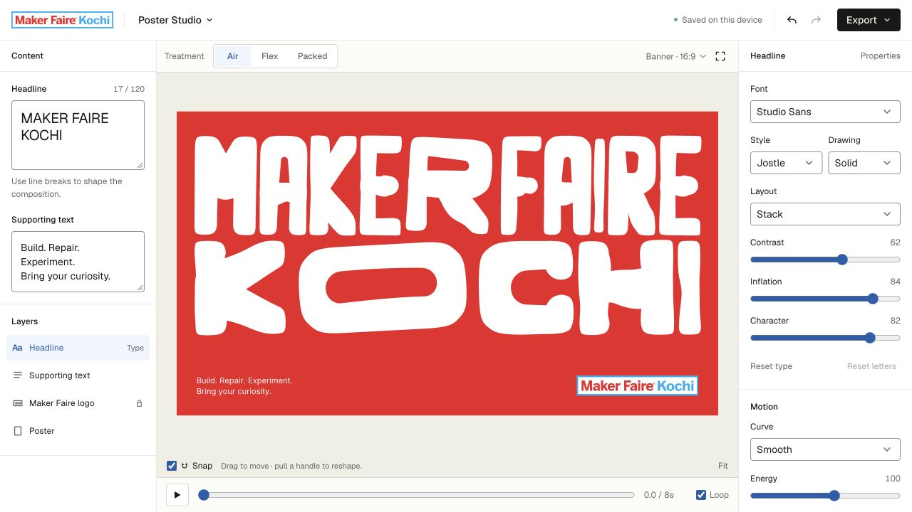
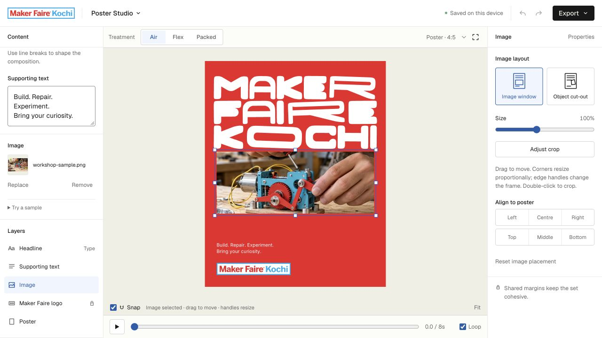
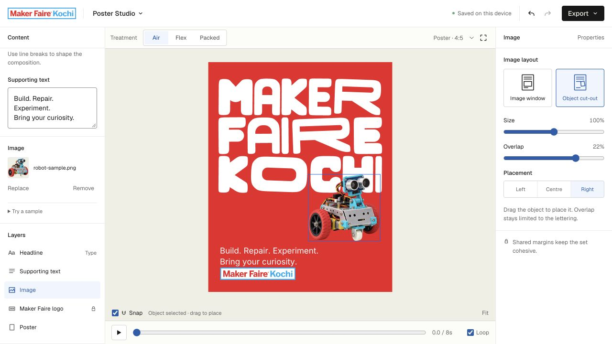

# Maker Faire Kochi Poster Studio

Make expressive posters with letters that stretch, share space and move together. Poster Studio combines direct canvas editing, a small set of lettering treatments and the Maker Faire Kochi colour palette in a browser-based tool.



## What you can make

- **Three treatments:** Air, Flex and Packed. Switching treatments keeps your font, layout, headline, supporting text and saved positions.
- **Expressive type:** seven font choices, optical spacing, selective exaggeration, inflation and outline drawing.
- **Direct editing:** drag letters, reshape them with handles, and move or resize the supporting text and logo.
- **Cohesive layouts:** shared margins, snapping, alignment controls and portrait, story, square and banner formats.
- **Motion posters:** seamless 20-second loops with Smooth, Steady, Punchy and Elastic curves.
- **Image layouts:** an Image window for photography and an Object cut-out layout for transparent objects, with local upload and crop or overlap controls.
- **Portable output:** PNG images, outlined SVG artwork, video loops and editable JSON project files.

The editor renders artwork and saves projects in your browser. It requires no account, application backend or API keys. Fonts and artwork assets are bundled locally; the application contains no analytics or cloud upload integration.

## Get started

Install [Node.js](https://nodejs.org/) 22 or newer, then:

```sh
git clone https://github.com/niyamax/maker-faire-kochi-poster-studio.git
cd maker-faire-kochi-poster-studio
npm ci
npm run dev
```

Open **[http://127.0.0.1:8800/](http://127.0.0.1:8800/)**. The development server listens only on your computer. JavaScript and CSS changes rebuild automatically; refresh the browser to see them.

If the port is occupied, set the `PORT` environment variable before starting the server. For example, in a POSIX shell:

```sh
PORT=8801 npm run dev
```

## Create a poster

1. Enter a headline and supporting text. Headlines accept **120 characters**, including spaces and line breaks. Press Enter to start a new poster line. Repeated spaces, leading spaces and trailing spaces are retained for gaps and indentation in every format.
2. Choose **Air**, **Flex** or **Packed** above the canvas, then select a font and layout in the properties panel.
3. Adjust **Contrast** for emphasis, **Inflation** or **Stroke** for drawing weight, and **Character** for shape variation.
4. Select **Headline** in Layers to move the whole headline frame. Drag its body, use corner or side handles, or enter X, Y, width and height in poster pixels. **Scale** keeps the letter shapes proportional; **Fill frame** lets side handles and independent width/height values reshape the lettering inside the frame. **Fit width**, **Fit height**, **Centre** and **Reset frame** provide quick placement actions. Proportional fitting stays inside the poster margins, so the other dimension can limit its size.
5. Choose **Letters**, or double-click a headline letter, to adjust individual letters. Drag a letter to move it and pull its handles to reshape it; nearby letters make room. Frame placement and individual adjustments are saved separately. Animation runs within the saved frame and does not bake an animated pose into the edit. Manual line breaks and repeated spaces are retained. Select supporting text to align its lines left, centre or right. Text and logo blocks can also be resized or aligned to the poster.
6. Pick a palette or set custom colours. Press Play to preview motion, then export.

Studio Sans preserves uniform strokes while protecting G/C openings, E/F bar spacing and closed counters. Inflation and outline limits ease back as a letter becomes compressed. The G's crossbar accounts for its rounded tip and the bowl beside it. Flex uses the same constrained stroke width for construction and drawing, and its centreline paths remain stroked in Solid drawing so their counters stay open. Preview and exports share this geometry.


### Add an image

New posters start with the **Studio robot** cut-out. Saved projects retain their selected image, including posters with no image. Use **Replace** or **Add image** in the content panel, or the **Samples** dropdown beside the Image heading, to choose another image.

- **Image window** starts with a composed photo frame. Drag it anywhere on the poster. Corner handles resize it proportionally; edge handles change the frame shape. Double-click the photo or choose Adjust crop to reframe its contents with dragging and Crop zoom.
- **Object cut-out** places a transparent PNG or WebP in front of the lettering. Drag it freely in two dimensions and use corner handles or Size to resize it without distortion. Moving the object keeps its size fixed. Type response controls how strongly the letters give way around the silhouette, from no response to full interaction.

Both layouts have poster alignment controls, snapping guides and Reset image placement. Images may extend beyond the poster edge for intentional cropping. Image position, frame size and crop are saved separately.

Upload PNG, JPG or WebP files up to 20 MB. The browser resizes and re-encodes images locally, preserves transparency, trims transparent padding and embeds the processed pixels in saved projects. All export formats use the same image placement. Removing an image restores the full typography frame while retaining your saved type settings and offsets.

| Image window | Object cut-out |
| --- | --- |
| [](docs/images/image-window.png) | [](docs/images/object-cutout.png) |

### Canvas shortcuts

| Action | Control |
| --- | --- |
| Move a selected item | Arrow keys |
| Bypass snapping while dragging | Hold Alt |
| Cancel a drag or clear selection | Escape |
| Play or pause with canvas focus | Space |
| Undo | Cmd/Ctrl + Z |
| Redo | Cmd/Ctrl + Shift + Z |

### Save your work

Projects autosave to local browser storage. Use **Poster Studio → Save project** to download an editable JSON file, and **Open project…** to restore it.

Browser storage is specific to the address and port you use. Save a project file before switching addresses, clearing browser storage or moving to another device. Project files contain the poster settings and any uploaded image. Fonts and the logo are supplied by the application. Project files can be up to 4 MB.

### Export

| Format | Output |
| --- | --- |
| PNG | A still image of the current poster |
| SVG | Vector artwork with outlined text and an embedded logo |
| Video | One complete 20-second loop, targeting twice the poster dimensions at 60 fps (up to 3840 pixels on its longest side) |

Video exports render every frame before encoding, using WebCodecs in quality mode. The default portrait target is 2160 × 2700 at 60 fps; Story and banner exports are capped at a 3840-pixel longest side. MP4 is preferred, with WebM and compatible resolution or frame-rate fallbacks reported in the result. Quality scales with output size. The video is available only after all frames are encoded and the file is finalized. Uploaded images retain their source resolution. A browser with WebCodecs support is required.

Headlines use the supported Latin uppercase letters, numbers and punctuation. Supporting text uses the bundled Inter character set and up to two lines. Connected-script shaping is not implemented.

## Build and development

| Command | Purpose |
| --- | --- |
| `npm run dev` | Start the local editor with JavaScript and CSS rebuilds |
| `npm run build` | Generate the distributable application in `dist/` |
| `npm run preview` | Serve an existing `dist/` build locally |
| `npm run protect:main` | Install the local guard against publishing held experiments |
| `npm test` | Run the geometry, motion, state and export tests |

The `dist/` folder can be served by a static web host. It includes the application, runtime assets, licence and asset notices. Keep these files together when distributing the build. The development server is for local use.

The npm package has `private: true` to prevent accidental publication to the npm registry; this does not restrict the public GitHub repository or the MIT licence.

### Development isolation

`main` contains the production editor. The held 3D and poster experiments live on the local-only branch `codex/3d-poster-experiments`, checked out separately in `../maker-faire-kochi-3d-lab`. Keep that branch local and do not merge its source or copy its generated files into `main` without explicit approval.

Each checkout has its own dependencies and `dist/` directory. Use port **8800** for the production editor and **8820** for the experiment preview. Save a project file before moving work between these addresses because browser storage is separate for each port.

Production builds clear `dist/` and reject experimental source paths, bundled inputs and preview outputs. CI runs this guarded build for `main` and pull requests targeting it. Run `npm run protect:main` after cloning to install the additional Git push guard; it blocks publishing the held branch and pushing experimental files to `main`.

### Source map

| Folder | Contents |
| --- | --- |
| `src/` | Editor, typography geometry, alignment, motion and export |
| `src/data/` | Precompiled font outlines, supporting-text paths and embedded logo |
| `src/styles/` | Editor styles and design tokens |
| `assets/` | Source fonts, logo and asset manifests |
| `public/` | Application HTML |
| `scripts/` | Build, local server and optional font generation |
| `tests/` | Rendering, continuity, positioning, state and export tests |

Precompiled outlines are included, so normal builds need only Node.js. To regenerate them, install `fonttools[woff]` in a Python virtual environment and run:

```sh
python scripts/build-fonts.py
python scripts/build-copy-font.py
```

## Contributing

Bug reports, improvements and contributions are welcome. See [CONTRIBUTING.md](CONTRIBUTING.md) for the development workflow and guidance for visual changes. You can [report a bug or suggest a feature](https://github.com/niyamax/maker-faire-kochi-poster-studio/issues/new/choose).

## Licence and assets

The **application code is licensed under MIT**. See [LICENSE](LICENSE).

Bundled fonts and their derived outlines retain the **SIL Open Font License 1.1**, with individual notices in [licenses/](licenses/) and source details in [assets/font-manifest.json](assets/font-manifest.json).

The Maker Faire Kochi logo and Maker Faire names and marks are separate from the application-code licence. No trademark rights are granted. See [NOTICE.md](NOTICE.md) for the asset notices.

Video encoding and MP4/WebM muxing use Mediabunny 1.62.1. The MPL-2.0 dependency notice and corresponding source link are in [NOTICE.md](NOTICE.md). All encoding runs locally on this device.
