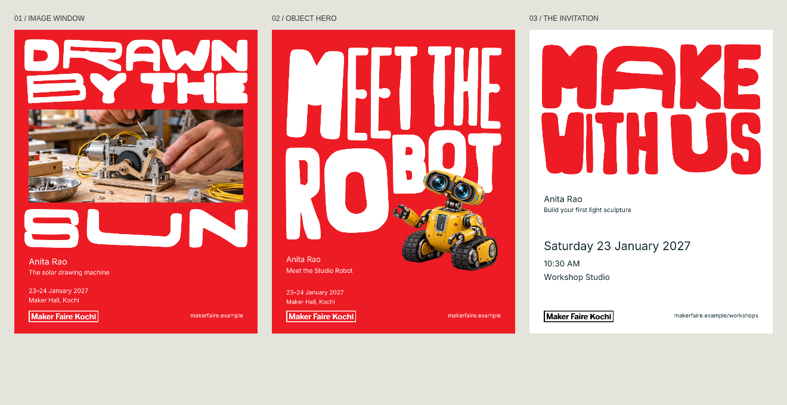
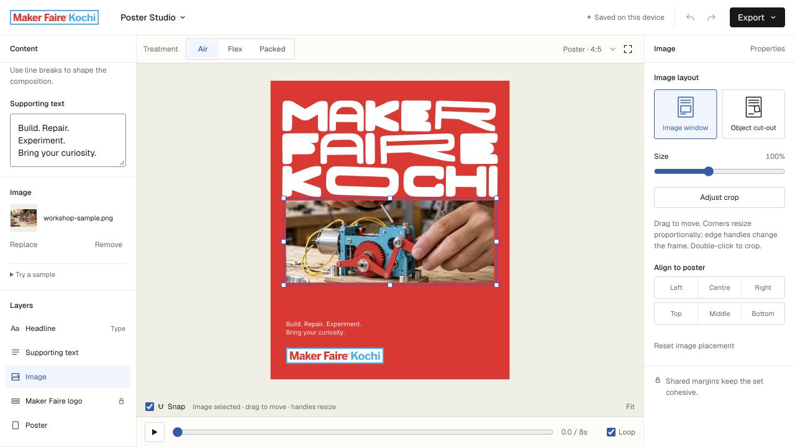
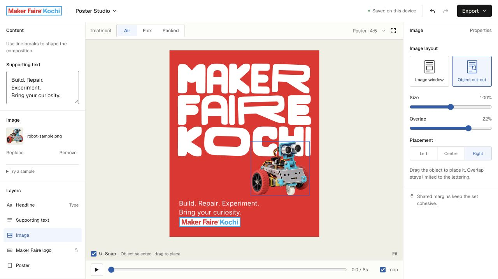

# Maker Faire Kochi Content Studio

Create Maker Faire Kochi social content from shared maker and workshop information. Content Studio combines a local content library, linked feed and Story designs, carousels and the expressive poster editor.

**[Open Content Studio](https://niyamax.github.io/maker-faire-kochi-poster-studio/)** · [Classic poster editor](https://niyamax.github.io/maker-faire-kochi-poster-studio/poster.html)



## Content library and social packs

Open the root page to create a **Maker Spotlight**, **Workshop**, or **Poster**. Name and duplicate items, edit the shared event details, and reopen your work from the library.

- **Maker Spotlight:** maker and project names, a short poster callout, description, handle, photographs and a link.
- **Workshop:** full title, poster callout, host, date, time, duration, location, description and booking link. Empty event fields inherit the shared event details.
- **Linked outputs:** feed at 1080 × 1350 and Story at 1080 × 1920 share content, colours and logo. Each output retains its own image zoom and focal point.
- **Carousels:** cover, details and closing pages, with custom callouts/body text, image selection, duplication, ordering and removal. Choose an automatic composition, photo window, object cut-out or type-only artwork per page. Add up to 30 pages and eight photographs per item.
- **Partner branding:** add a partner name and a dedicated logo alongside the Maker Faire identity, independently of the photo gallery.
- **Sharing packs:** individual PNG/SVG outputs or an ordered ZIP of feed and Story PNGs, an editable project, caption text, image descriptions and an output manifest. Video export uses the same selected page and motion geometry.
- **Editing guides:** toggle Story safe-area guides in the preview. Guides are omitted from exports; add native social links and stickers on the destination platform.

Templates follow the [Content Studio art direction](docs/art-direction.md) and use the original hero poster lettering engine. Air, Flex and Packed shape a substantial typographic field, with the same optical spacing, letter character and motion as the poster editor. Photo windows sit between rows of lettering; transparent objects interrupt the field and the letters respond to their silhouette; type-only callouts reclaim the full artwork area. Names, complete official titles and practical facts have separate reading areas.

Red and white lead the example series. Photographs retain their own colours and material character; the renderer does not tint them to match the brand. Dates, times and venues use stable Inter lettering as one factual reading block. The expressive treatment belongs to the main callout. Cyan remains an optional palette.

Write a short **Poster callout**, using Enter for two to four deliberate lines, while retaining the full project or workshop title in its own field. A page's optional callout overrides the shared cover wording. Feed and Story are composed separately. Whole secondary blocks, or complete sentences from a longer story, are selected for the artwork; the complete source stays in the project and sharing pack caption. New packs automatically choose a contrasting monochrome logo; turn off Automatic contrast to choose a specific supplied colour variant.

The library saves to **IndexedDB on this device**. The first visit migrates a previously saved Poster Studio project into a library item. Imported v1 poster files keep their original artwork, media, fonts, logo and placement, and open in the classic editor at `/poster.html`. Use the editor’s back link to return to the library after saving.

Download a project JSON or ZIP to hand work to another person or device. This release has no shared server, account permissions, live collaboration or social publishing integration. Organisers, volunteers and partners can exchange files; a shared workspace is a later phase.

Template text currently uses the bundled Latin glyphs. Text that cannot be rendered or fit within a master is kept in the caption and project, and the preview identifies these editorial omissions. Malayalam shaping is a separate future text-rendering task.

## Poster editor

- **Three treatments:** Air, Flex and Packed. Switching treatments keeps your font, layout, headline, supporting text and saved positions.
- **Expressive type:** seven font choices, optical spacing, selective exaggeration, inflation and outline drawing.
- **Direct editing:** drag letters, reshape them with handles, and move or resize the supporting text and logo. Select the logo to choose its long, bordered or square layout in original colours, black or white.
- **Cohesive layouts:** shared margins, snapping, alignment controls and portrait, story, square and banner formats.
- **Motion posters:** seamless eight-second loops with Smooth, Steady, Punchy and Elastic curves.
- **Image layouts:** an Image window for photography and an Object cut-out layout for transparent objects, with local upload and crop or overlap controls.
- **Portable output:** PNG images, outlined SVG artwork, video loops and editable JSON project files.

The studio renders artwork and saves projects in your browser. It requires no account, application backend or API keys. Fonts and artwork assets are bundled locally; the application contains no analytics or cloud upload integration.

## Get started

Install [Node.js](https://nodejs.org/) 22 or newer, then:

```sh
git clone https://github.com/niyamax/maker-faire-kochi-poster-studio.git
cd maker-faire-kochi-poster-studio
npm ci
npm run dev
```

Open **[http://127.0.0.1:8800/](http://127.0.0.1:8800/)** for Content Studio. The classic poster editor is at `/poster.html`. The development server listens only on your computer. JavaScript and CSS changes rebuild automatically; refresh the browser to see them.

If the port is occupied, set the `PORT` environment variable before starting the server. For example, in a POSIX shell:

```sh
PORT=8801 npm run dev
```

## Create a poster in the classic editor

1. Enter a headline and supporting text. Headlines accept **120 characters**, including spaces and line breaks. Press Enter to start a new poster line. Repeated spaces, leading spaces and trailing spaces are retained for gaps and indentation in every format.
2. Choose **Air**, **Flex** or **Packed** above the canvas, then select a font and layout in the properties panel.
3. Adjust **Contrast** for emphasis, **Inflation** or **Stroke** for drawing weight, and **Character** for shape variation.
4. Drag a letter to move it. Pull its handles to reshape it; nearby letters make room. Select supporting text to align its lines left, centre or right. Text and logo blocks can also be resized or aligned to the poster.
5. Choose a Maker Faire red, white or cyan palette, or set custom colours. Select **Maker Faire logo** in Layers (or click the logo on the canvas) to change its layout and colour. Black and white logos have transparent backgrounds; choose white for dark fields and black for light fields. Logo choices are retained when switching treatments, undoing, saving and exporting. Press Play to preview motion, then export.

### Add an image

New posters start with the **Studio robot** cut-out. Saved projects retain their selected image, including posters with no image. Use **Replace** or **Add image** in the content panel, or the **Samples** dropdown beside the Image heading, to choose another image.

- **Image window** starts with a composed photo frame. Drag it anywhere on the poster. Corner handles resize it proportionally; edge handles change the frame shape. Double-click the photo or choose Adjust crop to reframe its contents with dragging and Crop zoom.
- **Object cut-out** places a transparent PNG or WebP in front of the lettering. Drag it freely in two dimensions and use corner handles or Size to resize it without distortion. Moving the object keeps its size fixed. Type response controls how strongly the letters give way around the silhouette, from no response to full interaction.

Both layouts have poster alignment controls, snapping guides and Reset image placement. Images may extend beyond the poster edge for intentional cropping. Image position, frame size and crop are saved separately.

Upload PNG, JPG or WebP files up to 20 MB. The browser resizes and re-encodes images locally, preserves transparency, trims transparent padding and embeds the processed pixels in saved projects. All export formats use the same image placement. Removing an image restores the full typography frame while retaining your saved type settings and offsets.

| Image window | Object cut-out |
| --- | --- |
| [](docs/images/image-window.png) | [](docs/images/object-cutout.png) |

### Canvas shortcuts

| Action | Control |
| --- | --- |
| Move a selected item | Arrow keys |
| Bypass snapping while dragging | Hold Alt |
| Cancel a drag or clear selection | Escape |
| Play or pause with canvas focus | Space |
| Undo | Cmd/Ctrl + Z |
| Redo | Cmd/Ctrl + Shift + Z |

### Save your work

Classic posters autosave to local browser storage. Posters opened from the content library also save back into their library item. Use **Poster Studio → Save project** to download an editable JSON file, and **Open project…** to restore it.

Browser storage is specific to the address and port you use. Save a project file before switching addresses, clearing browser storage or moving to another device. Project files contain the poster settings and any uploaded image. Fonts and the logo are supplied by the application. Project files can be up to 4 MB.

### Export

| Format | Output |
| --- | --- |
| PNG | A still image of the current poster |
| SVG | Vector artwork with outlined text and an embedded vector logo |
| Video | One complete eight-second loop, targeting twice the poster dimensions at 60 fps (up to 3840 pixels on its longest side) |

Video exports render every frame before encoding, using WebCodecs in quality mode. The default portrait target is 2160 × 2700 at 60 fps; Story and banner exports are capped at a 3840-pixel longest side. MP4 is preferred, with WebM and compatible resolution or frame-rate fallbacks reported in the result. Quality scales with output size. The video is available only after all frames are encoded and the file is finalized. Uploaded images retain their source resolution. A browser with WebCodecs support is required.

Headlines use the supported Latin uppercase letters, numbers and punctuation. Supporting text uses the bundled Inter character set and up to two lines. Connected-script shaping is not implemented.

## Build and development

| Command | Purpose |
| --- | --- |
| `npm run dev` | Start the local editor with JavaScript and CSS rebuilds |
| `npm run build` | Generate the distributable application in `dist/` |
| `npm run preview` | Serve an existing `dist/` build locally |

The `dist/` folder can be served by a static web host. It includes the application, runtime assets, licence and asset notices. Keep these files together when distributing the build. The development server is for local use.

GitHub Pages serves the built application from the root of the `gh-pages` branch. To publish an update, run `npm run build` and commit the contents of `dist/` to that branch, retaining `.nojekyll`. Source changes are reviewed separately; pushing a source branch alone does not update the live site. The published `deployment.json` records the source commit for the current build.

The npm package has `private: true` to prevent accidental publication to the npm registry; this does not restrict the public GitHub repository or the MIT licence.

### Source map

| Folder | Contents |
| --- | --- |
| `src/` | Content project model, storage, templates, pack exports, poster editor |
| `src/data/` | Precompiled font outlines, supporting-text paths and embedded logo |
| `src/styles/` | Editor styles and design tokens |
| `assets/` | Source fonts, logo and asset manifests |
| `public/` | Application HTML |
| `scripts/` | Build, local server and optional font generation |

Embedded logo SVGs are also included. After editing files in `assets/logos/`, regenerate them with `node scripts/build-logos.mjs` and update their checksums in `assets/logo.json`.

Precompiled outlines are included, so normal builds need only Node.js. To regenerate them, install `fonttools[woff]` in a Python virtual environment and run:

```sh
python scripts/build-fonts.py
python scripts/build-copy-font.py
```

## Contributing

Bug reports, improvements and contributions are welcome. See [CONTRIBUTING.md](CONTRIBUTING.md) for the development workflow and guidance for visual changes. You can [report a bug or suggest a feature](https://github.com/niyamax/maker-faire-kochi-poster-studio/issues/new/choose).

## Licence and assets

The **application code is licensed under MIT**. See [LICENSE](LICENSE).

Bundled fonts and their derived outlines retain the **SIL Open Font License 1.1**, with individual notices in [licenses/](licenses/) and source details in [assets/font-manifest.json](assets/font-manifest.json).

The Maker Faire Kochi logo and Maker Faire names and marks are separate from the application-code licence. No trademark rights are granted. See [NOTICE.md](NOTICE.md) for the asset notices.

Video encoding and MP4/WebM muxing use Mediabunny 1.62.1. The MPL-2.0 dependency notice and corresponding source link are in [NOTICE.md](NOTICE.md). All encoding runs locally on this device.
