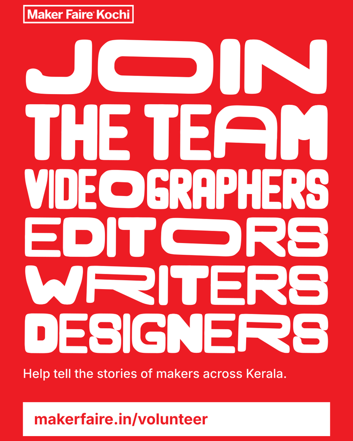
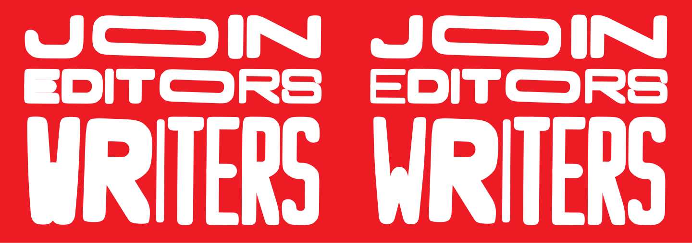

# Reel: The team grows

A 15-second vertical Reel that calls for media volunteers. The headline fills the poster, each role joins as a new row of lettering, and the rows above redraw themselves shorter to make room. It is rendered by `scripts/reel/team-grows.mjs` with the same lettering engine as the poster editor.



This page records how to run it, what each number does, and why the reel looks the way it does, so the next one starts from the decisions and not from scratch.

## Run it

You need Node 22 or newer, plus `rsvg-convert` (librsvg) and `ffmpeg` on your PATH. On macOS: `brew install librsvg ffmpeg`. Run from the repository root.

```sh
# 1080 × 1920, silent
node scripts/reel/team-grows.mjs --out reel.mp4

# 4K (2160 × 3840) with muffled music
node scripts/reel/team-grows.mjs --out reel-4k.mp4 --scale 2 --music lobby-time.mp3 --music-start 83.85

# One frame as a PNG, for a cover or end card
node scripts/reel/team-grows.mjs --still 14.9 --out end-card.png --scale 2
```

| Option | Meaning | Default |
| --- | --- | --- |
| `--out` | Output file | `team-grows.mp4` |
| `--scale` | 1 for 1080 × 1920, 2 for 4K. Frames are redrawn from vectors, not upscaled. | 1 |
| `--music` | Audio file to muffle and lay under the video | none (silent) |
| `--music-start` | Where in the track the 15-second excerpt starts, in seconds | 0 |
| `--still` | Write the frame at this time (seconds) as a PNG instead of a video | none |

A 1080p render takes about a minute; 4K takes a few. The script writes frames to a temporary folder and removes them when it finishes.

## Make a new reel

Everything you would change sits in the `CONFIG` block at the top of the script.

| To change | Edit |
| --- | --- |
| Headline rows | `headline`: text, share of height, entry time |
| Roles or other joining rows | `roles`: text and entry time. Add or remove rows freely; add a matching time to `rollCall`. |
| Story line and link | `story`, `url` |
| Colours | `colors.bg`, `colors.fg` |
| Lettering style | `treatment`: `air`, `flex` or `packed` |
| Length | `duration`, then move `relaxAt`, `rollCall` and `footerAt` to suit |
| Logo | `logo`: any id from `src/logo-library.js` |

Headlines accept the engine's character set: Latin capitals, digits and `& ! ? . -`. Keep each row to one or two words. A row of 13 letters (VIDEOGRAPHERS) is about the longest that stays comfortable at this width.

## The concept

**Success question:** can someone scrolling with the sound off tell, within a few seconds, that Maker Faire Kochi wants videographers, editors, writers and designers, and where to sign up?

**The one bold move** is the lettering itself. The message "join the team" is acted out by the type: the team literally grows, and the headline makes room for each new member. Everything else on the poster stays quiet so that move reads.

Earlier directions and why they were dropped:

- **Squashing a picture of the headline.** The first version stretched an exported PNG of the lettering. Strokes thickened and thinned as it moved. The engine can redraw every letter at any size with even strokes, so the reel now asks it for a fresh layout on every frame.
- **Small centred text blocks.** Logo, story line, a 2 × 2 grid of roles and the link were each centred on their own, so nothing lined up. Now there is one column and one left edge.
- **Hard sync to a beat grid.** A version that timed every move to the music's pulse felt like it was trying too hard. The motion now follows its own easing, and the music sits underneath.
- **A cursor dragging a resize handle, and a name tag pushing letters aside.** Both worked as gags but added an object that was not part of the message.
- **An arrow on the link bar.** A link in a video cannot be tapped, and an arrow suggests it can. The white bar is enough.
- **A centred logo.** The story line and link are left-aligned, so the logo stays on the same edge.

## Layout

The frame is 1080 × 1920. All content sits inside the centred 4:5 area (y 285 to 1635), because that is what the profile grid shows and it clears the app's top and bottom controls.

| Element | Position | Notes |
| --- | --- | --- |
| Left edge and column | x 70, width 940 | Shared by every element. 70 px matches the editor's own margin. |
| Logo | top 300, width 340 | White long variant; sits better on red than the boxed colour logo. |
| Lettering field | y 396 to 1620, then to 1372 | Gives up its lower 248 px when the footer arrives. |
| Gap between rows | 14 px | |
| Story line | baseline 1442, Inter 500, 38 px | One sentence, one line. |
| Link bar | y 1516 to 1620, white | Link in Inter 700, 46 px, red, inset 34 px. |

Type has three roles only: the lettering (the message), the story line (context) and the link (action). The roles are set in the lettering, not in body text, so the final card is one typographic block.

Row heights are shares of the field. The two headline rows weigh 1.4 each and every role weighs 1. A larger headline share (1.55) made the role rows short and their letters too wide to read comfortably.

## Timeline

| Time (s) | What happens |
| --- | --- |
| 0.1, 0.45 | JOIN and THE TEAM rise in and fill the field, inflating from thin to full. |
| 2.0, 3.1, 4.2, 5.3 | Each role joins at the bottom. The newest role is the tallest row (+75%) so it is easy to read as it lands, then relaxes when the next arrives. |
| 6.5 | The last role relaxes. All four are equal. |
| 7.2 to 9.15 | Roll call: each role swells once (+60%), top to bottom, 0.65 s apart. |
| 10.0 | The field tightens. Half a second later the story line and link bar slide up 36 px and fade in. |
| 10.5 to 15 | End card holds. The letters keep breathing on the studio's 8-second loop. |

Roles enter 1.1 s apart: long enough to read one word, short enough to keep moving.

## Motion

- **Rows grow on a spring** (1.7 Hz, damping 0.62). It overshoots slightly and settles in about half a second. Stiffer springs looked mechanical; looser ones made the whole block wobble.
- **Letters inflate as they arrive.** The engine's Inflation setting (`pressure`) runs from 0.25 to 0.84 over 0.7 s.
- **Letters never fully stop.** The engine's loop phase advances at one cycle per 8 s with the `smooth` curve at 0.9 energy. Each row is offset by 0.13 of a cycle so rows do not breathe in unison.
- **The footer waits.** It appears only after the field has finished making room, so text never crosses the lettering.

## Letter fixes

Short, wide rows exposed three shapes in the Air lettering. They are corrected in the engine, so the poster editor benefits too. Before is on the left, after on the right.



| Letter | Problem | Fix | File |
| --- | --- | --- | --- |
| E | Stroke thickness was sized for two-bar letters, so the three bars merged into a block. | E gets its own, thinner limit (0.112 of height). | `src/air-glyphs.js` |
| W | Four thick diagonals fused in tall rows, leaving only a notch. | W's stroke is limited to 0.15 of its width, not 0.235. | `src/air-glyphs.js` |
| J | In wide rows the hook curled up to half height and the letter read as U. | The hook stops at 0.2 of the height, and J's width ratio drops from 0.65 to 0.56. | `src/flex-glyphs.js` |

Trade-off: E and W are now slightly lighter than their neighbours in the rows where the old shapes broke. The J change also narrows J a little in every poster.

## Music

The reel works silent. When music is added it is treated to sound like it is playing in the next room, and balanced for phone speakers.

- **Track used:** "Lobby Time" by Kevin MacLeod (incompetech.com), CC BY 4.0, starting at 83.85 s. Slow lounge jazz suits the slow breathing of the letters. Fast swing and funk made the lack of beat sync obvious.
- **Filter chain:** two high-passes at 120 Hz, a 4 dB lift around 450 Hz, then three low-passes at 950 to 1000 Hz. Phone speakers barely play below 150 Hz, so a muffle that keeps only bass sounds thin on a phone. The lift keeps the tune audible.
- **Level:** +2 dB, limited with `alimiter=limit=0.7:level=0`, giving a mean of about −19 dB and peaks near −3 dB. Leave `level=0` in place: without it the limiter pushes peaks back up to full scale.
- **Fades:** 0.04 s in, 2.2 s out.
- **Start point:** chosen so some accents fall near the role entries. Nothing in the animation moves to fit the track.

Credit the track wherever the reel is posted: "Lobby Time" by Kevin MacLeod (incompetech.com), licensed under CC BY 4.0.

## Export settings

H.264, CRF 17, `yuv420p`, BT.709 limited range, 30 fps, `+faststart`; AAC at 192 kbps. Footer text is set in the Inter font bundled in `assets/fonts`, loaded through a temporary fontconfig file so the result does not depend on fonts installed on the machine.

## Known limits

- Lettering is Latin capitals only, as in the editor. Malayalam is not supported.
- Role rows longer than about 13 letters become narrow and hard to read.
- The script lays out each row on its own, so the engine's cross-row features (letter dragging, cut-out response) are not used here.
