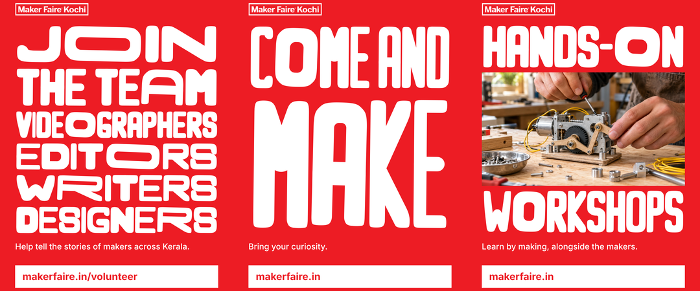

# Reels

Scripts in `scripts/reel/` render vertical Reels with the same lettering engine as the poster editor, outside the browser. Every frame lays the letters out afresh, so rows can change height without their strokes distorting.



| Style | Script | What happens | Good for |
| --- | --- | --- | --- |
| The team grows | `team-grows.mjs` | The headline fills the poster. Each item joins as a new row and the rows above shrink to make room. | Calls with a short list: roles, line-ups, what to bring |
| Swap | `swap.mjs` | One line stays. The other keeps changing: each new word rises from below and presses the last one flat. | Invitations, lists of activities |
| Window | `window.mjs` | Two lines fill the poster, then part to open a photograph between them. | Workshops, maker spotlights |

For campaign announcements and callouts, see the [angled reveal and date card recipe](reel-date-reveal.md). It documents the silent Maker Faire Kochi reference cut and its finished date hold.

For an awareness example with a photo-led opening and diagonal folds, see [What Is a Maker Faire?](reel-what-is-a-maker-faire.md). The guide includes the editable canvas reel and its reference MP4.

## Run one

You need Node 22 or newer, plus `rsvg-convert` (librsvg) and `ffmpeg` on your PATH. On macOS: `brew install librsvg ffmpeg`. Run from the repository root.

```sh
node scripts/reel/swap.mjs --out swap.mp4
node scripts/reel/window.mjs --out window.mp4 --photo path/to/photo.jpg
node scripts/reel/team-grows.mjs --out reel-4k.mp4 --scale 2 --music lobby-time.mp3 --music-start 83.85
node scripts/reel/swap.mjs --still 10.5 --out end-card.png --scale 2
```

| Option | Meaning | Default |
| --- | --- | --- |
| `--out` | Output file | `<style>.mp4` |
| `--scale` | 1 for 1080 × 1920, 2 for 4K. Frames are redrawn from vectors, not upscaled. | 1 |
| `--music` | Audio file to muffle and lay under the video | none (silent) |
| `--music-start` | Where in the track the excerpt starts, in seconds | 0 |
| `--still` | Write the frame at this time (seconds) as a PNG instead of a video | none |
| `--photo` | `window.mjs` only: the photograph to show | the sample workshop image |

A 1080p render takes about a minute; 4K takes a few. Frames go to a temporary folder that is removed afterwards.

## Change the content

Each script has a `CONFIG` block at the top. It starts from the shared `DEFAULTS` in `core.mjs` and overrides what the style needs.

| To change | Edit |
| --- | --- |
| Words and when they arrive | The style's own entries: `headline` and `roles`, `lead` and `words`, or `above` and `below` |
| Story line and link | `story`, `url`. Leave `story` empty to show only the link bar. |
| Colours | `colors.bg`, `colors.fg`; optionally `text`, `bar` and `barText` for the footer |
| Logo | `logo`: any id from `src/logo-library.js`. Use `long-white` on red and `long-colour` on white. |
| Lettering | `treatment`: `air`, `flex` or `packed` |
| Length | `duration`, then move the style's times and `footerAt` to suit |
| Feel | `motion`: spring, inflation and the breathing loop |

Lettering accepts Latin capitals, digits and `& ! ? . -`. Keep rows to one or two words; about 13 letters is the longest that stays readable at this width.

The sample wording and the sample photograph are placeholders. Replace both before posting: the workshop image is a generated demonstration asset, not a photograph of a real event.

## Shared design

The three scripts above use one layout so a series looks like a set. The reasons are in [Reel: The team grows](reel-team-grows.md).

- **One left edge.** Logo, lettering, story line and link bar share a 940 px column starting at x 70.
- **Inside the 4:5 crop.** Everything sits between y 285 and 1635, which is what the profile grid shows and what clears the app's controls.
- **Three kinds of text.** The lettering carries the message, one story line gives context, and one bar holds the link. The link has no arrow, because a link in a video cannot be tapped.
- **Red and white.** White lettering on red, or red on white.
- **The footer waits.** The lettering tightens first; the story line and link appear half a second later, so text never crosses the letters.
- **Letters keep breathing.** The studio's 8-second loop runs throughout, including on the end card.
- **Motion follows its own easing, not the music.** A version timed to a beat grid felt forced. Music, when used, is muffled and sits underneath.

## Notes on each style

**The team grows.** Full decisions, timeline and music treatment are in [Reel: The team grows](reel-team-grows.md).

**Swap.** The changing word is about twice the height of the fixed line (`wordWeight` 2.1 against 1), so it is the thing you read. Words are 2.1 s apart: enough to read one and see it give way. An outgoing word thins as it is pressed flat (`deflate`), which reads as being squeezed out and not just scaled. Long words such as EXPERIMENT become tall and narrow; that is fine for a beat, but end on a short word, because the last one stays for the end card.

**Window.** The photograph takes a little over half the field (`windowWeight` 2.5 against 1 for each line). It opens on a slower, calmer spring than the lettering so the picture does not bounce. The photo covers the window and is cropped around `focus`; set that to the part that must stay visible. A slow pull-back (`zoomFrom` to `zoomTo`) keeps the picture alive without drawing attention. Photographs keep their own colours and are never tinted.

## Write another style

A style is one function, `frame(t, config, assets)`, that returns the SVG for time `t` in seconds. `core.mjs` supplies the pieces:

| Helper | Use |
| --- | --- |
| `createScene(config)` | Background and logo |
| `stackRows(weights, top, bottom, config)` | Share the field between rows; a weight near 0 means the row is absent |
| `drawRow(scene, text, rect, {...})` | One row of live lettering, inflated and breathing |
| `fieldBottom(t, config)` | Bottom of the field, which rises when the footer arrives |
| `footerMarkup(t, config)` | Story line and link bar |
| `rise`, `spring`, `ease`, `easeOut` | Entrances and transitions |
| `prepareImage(path, workDir)` | Copy a photo next to the frames and read its size |
| `runReel({name, config, frame, prepare})` | Command-line options, rendering and encoding |

Animate a row by animating its weight. Start from `swap.mjs`, which is the shortest.
